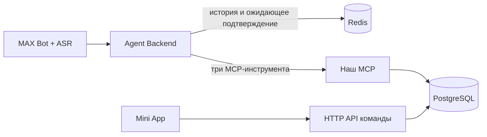

# Как стыкуем части команды

## Границы ответственности

Бот передаёт backend доверенный user_id и текст/ASR. Агент уточняет детали,
получает согласие и вызывает MCP. Redis читает и обновляет именно backend,
а не LLM самостоятельными инструментами. Mini App работает через HTTP API,
не подключается к PostgreSQL/Redis и не получает их пароль.

## Адреса полного Docker-стека

| Компонент | Клиент на этом компьютере | Клиент в той же Docker-сети |
| --- | --- | --- |
| MCP, Streamable HTTP | http://127.0.0.1:8001/mcp | http://mcp:8001/mcp |
| Готовность MCP + чтение БД | http://127.0.0.1:8001/health | http://mcp:8001/health |
| PostgreSQL | 127.0.0.1:55432 | postgres:5432 |
| Redis | redis://127.0.0.1:6380/0 | redis://redis:6379/0 |

БД assistant_mvp, роль приложения assistant_app, пароль STACK_APP_PASSWORD
из локального .env.docker. STACK_DB_PASSWORD — отдельный пароль владельца для
миграций/тестов, в агента и HTTP API его передавать не нужно.
Роль приложения имеет только SELECT/INSERT событий. Для будущих изменений
статуса нужны согласованные методы и отдельная миграция прав.

Значения порта на компьютере можно изменить в .env.docker; внутренние порты
контейнеров остаются прежними. Прежний compose.yaml запускает только Redis
на 6379; для общей сборки используйте именно compose.full.yaml.

## Подключение агента

Для MCP: endpoint из таблицы, имена/аргументы в README. Готовый Python-клиент
показан в app/check_mcp.py и docs/AGENT_INTEGRATION.md. Клиент команды может
быть другим, если поддерживает Streamable HTTP и JSON Schema этих инструментов.
Совместимость с реальным LangChain-адаптером команды ещё нужно проверить.

Для памяти: интерфейс ConversationStore и save_confirmed_event описан в
AGENT_INTEGRATION.md. Исходники Python backend может включить в общий репозиторий
с сохранением импортов. Сейчас это каталог app, не опубликованная pip-библиотека;
если у агента тоже пакет app, при объединении необходимо согласовать общий
namespace и пути импортов. Не копируйте только один memory.py без config.py
и confirmation.py. Для backend на другом языке нужен адаптер по тому же контракту.

У LLM нет права выбирать user_id: backend подставляет его из авторизованного
события бота. Текущее время и Europe/Moscow добавляет агент в свой prompt.
Историю system prompt не заменяет. При «да» агент должен знать, на какое
предложение согласился пользователь, и передать его idempotency_key.

## Подключение HTTP API

Читает те же public.events. Если API на Python, можно использовать EventService
при объединении кода; иначе нужны параметризованные SQL по описанной схеме.
Формат идентификатора пользователя, типы task/reminder/meeting, статусы
pending/done/cancelled и timezone-aware даты должны совпадать с MCP.
Список за день — [начало дня, начало следующего дня) в часовом поясе пользователя.
Все запросы обязаны фильтровать по доверенному user_id. Проверку доступа делает API.
Изменение/удаление событий этим модулем пока не предоставлено.

## Как объединить Docker-запуск

Самый простой вариант для хакатона — один общий compose команды: перенести
services postgres, redis, migrate, mcp из нашего compose.full.yaml и добавить
agent, bot, api. Внутри одной сети работают адреса mcp/postgres/redis из таблицы.
Агенту передать URL MCP и Redis; API — параметры assistant_app. Потребность в
записи статусов сначала согласовать. Не передавать владельца БД всем сервисам.
В другом Compose-проекте сеть автоматически не общая: подключите сервисы к
общей external network или объедините compose-файлы. В браузере Mini App
внутренние имена Docker недоступны — нужен адрес API.

GitHub синхронизирует код, но не работающие сервисы и не содержимое БД.
Если каждый участник запускает свою копию, у каждого своя база. Для общего
набора событий нужен один общий запуск, доступный команде; его адрес и доступ
ещё согласуются. VPS для независимой проверки скачанного кода не требуется.

## Что команда должна согласовать перед сквозным тестом

1. Кто запускает общую сборку, где размещён агент и какой MCP-клиент использует.
2. Единый источник user_id и часового пояса, авторизация бота/API.
3. Последовательная обработка сообщений одного пользователя и дедупликация MAX.
4. Кто отправляет напоминания по расписанию: наша запись reminder не запускает таймер.
5. Общая структура Python-пакетов и способ включения памяти в репозиторий агента.
